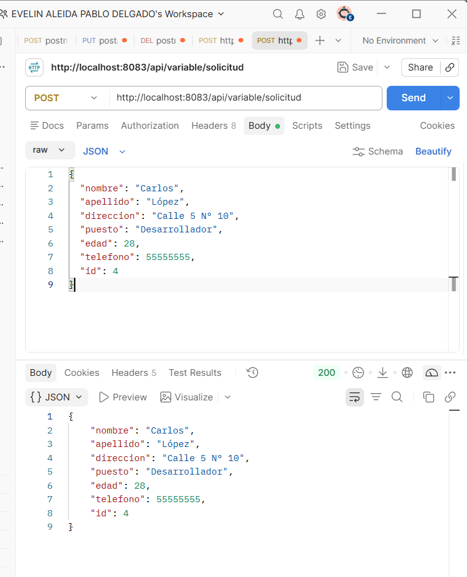

# Actividad 2 - Tema 4: MVC, Thymeleaf, DTOs y Manejo de Parámetros en Spring Boot

**Estudiante:** Evelin Aleida Pablo Delgado-EAPD  
**Repositorio:** `EAPDact2_t4`  
**Puerto Asignado:** `8083`  

---

## Descripción del Proyecto

Este proyecto es una continuación independiente de la Actividad 1. Implementa una aplicación web desarrollada con **Spring Boot** utilizando el patrón de diseño **Modelo-Vista-Controlador (MVC)**, el motor de plantillas **Thymeleaf**, transferencia de datos con **DTOs**, lectura de propiedades externas con `@Value`, y manejo de parámetros dinámicos mediante `@RequestParam`, `@PathVariable`, `@ModelAttribute` y `@RequestBody`.

---

## Tecnologías Utilizadas

* **Java 21 / Spring Boot 3+**
* **Thymeleaf** (`spring-boot-starter-thymeleaf`)
* **Maven**
* **Postman** (Pruebas de endpoints REST POST)
* **DigitalOcean VPS** (Despliegue en puerto 8083 sin afectar Actividad 1)

---

## Endpoints y Rutas Disponibles

### Vistas Web (Thymeleaf - MVC)
* **Catálogo y Búsqueda por Puesto (`@RequestParam`, `th:each`, `@Value`):**  
  `http://localhost:8083/detalles_info`
* **Formulario de Registro (`@ModelAttribute`):**  
  `http://localhost:8083/formulario`

### Endpoints REST API (JSON)
* **Detalle Dinámico (`@PathVariable`):**  
  `http://localhost:8083/api/variable/pagina1/{mensaje}`
* **Filtro REST (`@RequestParam`):**  
  `http://localhost:8083/api/parametros/detalle?informacion=Prueba`
* **Lectura de Propiedades (`@Value`):**  
  `http://localhost:8083/api/variable/valores`
* **Creación de Empleado REST (`@RequestBody` - POST):**  
  `POST http://localhost:8083/api/variable/solicitud`

---

### Petición POST con Postman (`@RequestBody`)
Prueba de envío de un objeto JSON mediante el método HTTP POST recibiendo un estado de respuesta `200 OK`.

